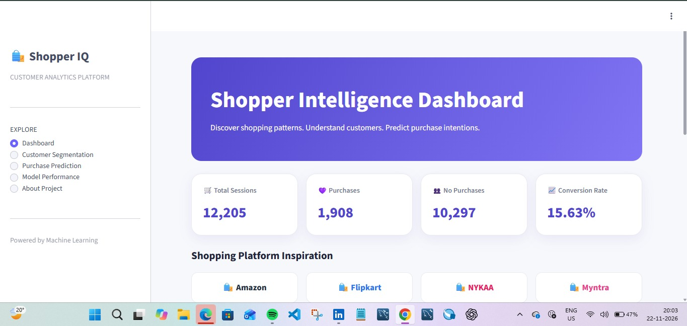
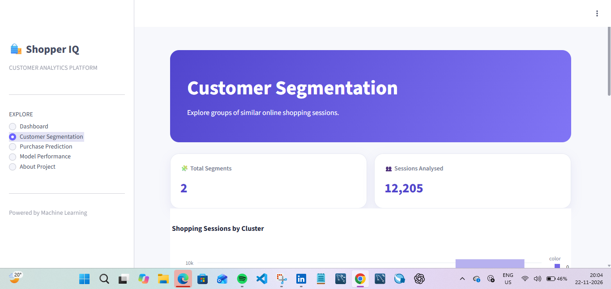
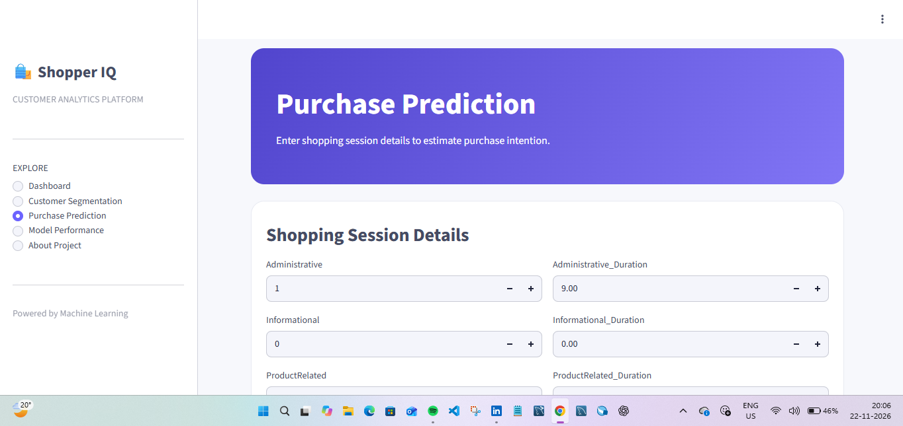
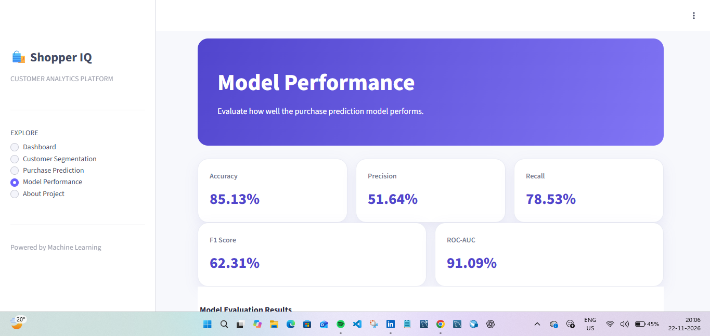
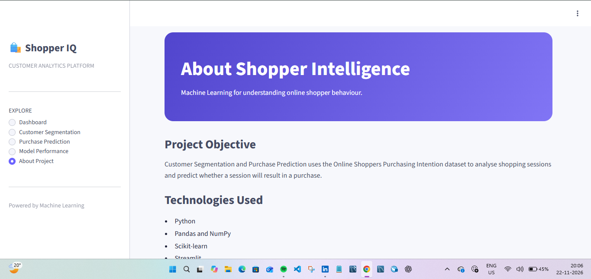

# Shopper Intelligence
### Customer Segmentation & Purchase Prediction

Shopper Intelligence is a Machine Learning-based project that analyzes online shopping-session behavior, segments similar sessions, and predicts whether a visitor is likely to make a purchase.

The project combines classification and clustering techniques and presents the results through an interactive Streamlit web application.

---

## Table of Contents

1. Project Overview
2. Objectives
3. Dataset
4. Technologies Used
5. Machine Learning Approach
6. Model Performance
7. Application Features
8. Application Screenshots
9. Project Structure
10. Installation and Execution
11. Future Scope
12. Conclusion

---

## 1. Project Overview

Online shopping platforms generate valuable information through visitors' browsing and interaction patterns. Understanding these patterns can help identify shopping sessions that are more likely to result in a purchase.

This project uses the **Online Shoppers Purchasing Intention Dataset** to perform:

- Exploratory Data Analysis (EDA).
- Purchase prediction using Logistic Regression.
- Shopping-session segmentation using K-Means Clustering.
- Model evaluation and visualization.
- Interactive analysis through a Streamlit web application.

**Note:** The clustering component groups shopping sessions based on behavioral patterns. It does not identify individual customers.

## 2. Objectives

- Analyze online shopping behavior and purchase intention.
- Perform data cleaning and preprocessing.
- Build a classification model to predict purchase outcomes.
- Apply clustering to identify groups of similar shopping sessions.
- Evaluate model performance using appropriate metrics.
- Develop an interactive dashboard to present the results.

## 3. Dataset

**Dataset:** Online Shoppers Purchasing Intention Dataset

- Total records: 12,330 sessions
- Total features: 18
- Target variable: `Revenue`

The `Revenue` column indicates whether a shopping session resulted in a purchase.

- `True` – Purchase made.
- `False` – No purchase made.

The dataset contains numerical and categorical features related to visitors' browsing behavior and session characteristics.

## 4. Technologies Used

| Technology | Purpose |
|---|---|
| Python | Programming language |
| Pandas | Data manipulation |
| NumPy | Numerical operations |
| Scikit-learn | Machine Learning and preprocessing |
| Matplotlib | Data visualization |
| Seaborn | Statistical visualization |
| Plotly | Interactive visualizations |
| Streamlit | Web application |
| Joblib | Saving and loading trained models |
| Jupyter Notebook | Model development |

## 5. Machine Learning Approach

The project uses two machine learning techniques for different tasks.

### A. Purchase Prediction – Logistic Regression

**Type:** Supervised Learning (Classification)

Logistic Regression is used to predict whether a shopping session will result in a purchase.

The workflow includes:

- Separating input features and target variable.
- Splitting the dataset into training and testing sets (80:20).
- Handling missing values using median and most-frequent imputation.
- Scaling numerical features using StandardScaler.
- Encoding categorical features using OneHotEncoder.
- Training Logistic Regression with class balancing.

### B. Shopping Session Segmentation – K-Means Clustering

**Type:** Unsupervised Learning (Clustering)

K-Means is used to group shopping sessions based on their behavioral characteristics.

The workflow includes:

- Excluding the `Revenue` column from clustering.
- Preprocessing numerical and categorical features.
- Exploring cluster counts from 2 to 6.
- Using the Elbow Method and Silhouette Score to help select the number of clusters.
- Training the final K-Means model with 2 clusters.

The resulting clusters represent groups of similar shopping sessions, not individually identified customers.

## 6. Model Performance

The Logistic Regression model achieved the following results on the test dataset:

| Evaluation Metric | Score |
|---|---:|
| Accuracy | 85.13% |
| Precision | 51.64% |
| Recall | 78.53% |
| F1 Score | 62.31% |
| ROC-AUC | 91.09% |

These metrics help evaluate the model from different perspectives. Precision and recall are particularly important when assessing purchase prediction performance.

## 7. Application Features

The Streamlit application includes the following sections:

| Section | Description |
|---|---|
| Dashboard | Provides an overview of shopping-session data and key statistics. |
| Customer Segmentation | Displays and explores the groups generated by K-Means. |
| Purchase Prediction | Predicts purchase outcomes using the trained classification model. |
| Model Performance | Displays the model evaluation metrics. |
| About Project | Provides information about the project and its objectives. |

## 8. Application Screenshots

The following screenshots showcase the different sections of the Streamlit application.

## Application Screenshots

### 1. Dashboard


### 2. Customer Segmentation


### 3. Purchase Prediction


### 4. Model Performance


### 5. About Project



## 9. Project Structure

```text
SML-Project/
│
├── .streamlit/
│   └── config.toml
│
├── Online Shopper Dataset.csv
├── Shopper Intelligence.ipynb
├── README.md
├── app.py
│
├── purchase_model.pkl
├── clustering_model.pkl
├── cluster_preprocessor.pkl
│
├── customer_data.csv
├── test_data.csv
└── model_metrics.json
```

### Important Files

- `Shopper Intelligence.ipynb` – Notebook containing data analysis, preprocessing, model training, and evaluation.
- `app.py` – Streamlit application.
- `Online Shopper Dataset.csv` – Original dataset.
- `purchase_model.pkl` – Saved Logistic Regression model.
- `clustering_model.pkl` – Saved K-Means model.
- `cluster_preprocessor.pkl` – Saved clustering preprocessing pipeline.
- `customer_data.csv` – Data used by the segmentation section.
- `test_data.csv` – Saved test data.
- `model_metrics.json` – Saved classification evaluation metrics.
- `.streamlit/config.toml` – Streamlit configuration file.

## 10. Installation and Execution

### Prerequisites

- Python installed on your system.
- Git installed on your system.
- Access to the project repository.

### Step 1: Clone the Repository

```bash
git clone https://github.com/DrishtiBansal-7002/SML-Project.git
```

### Step 2: Navigate to the Project Directory

```bash
cd SML-Project
```

### Step 3: Install Required Libraries

```bash
pip install streamlit pandas numpy scikit-learn matplotlib seaborn plotly joblib
```

### Step 4: Run the Streamlit Application

```bash
streamlit run app.py
```

The application will provide a local URL in the terminal. Open that URL in your browser to access the application.

**Note:** The notebook contains Google Colab-specific commands and a Colab dataset path. If running the notebook outside Google Colab, update the dataset path and environment-specific commands accordingly. The saved model files should also be loaded with a compatible scikit-learn version.

## 11. Future Scope

- Experiment with additional classification algorithms to compare prediction performance.
- Explore alternative clustering techniques.
- Improve the interpretation of shopping-session segments.
- Add more interactive visualizations to the dashboard.
- Incorporate additional behavioral features.
- Deploy the Streamlit application online for wider accessibility.

## 12. Conclusion

Shopper Intelligence demonstrates how Machine Learning techniques can be applied to online shopping-session data for purchase prediction and behavioral segmentation.

By combining Logistic Regression, K-Means Clustering, data visualization, and an interactive Streamlit application, the project brings model development and interactive analysis together in one platform.

---

**Project:** Shopper Intelligence – Customer Segmentation & Purchase Prediction


